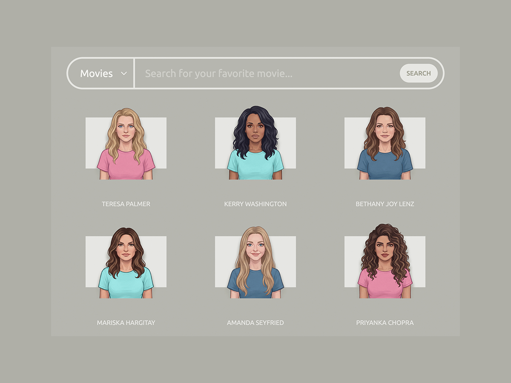
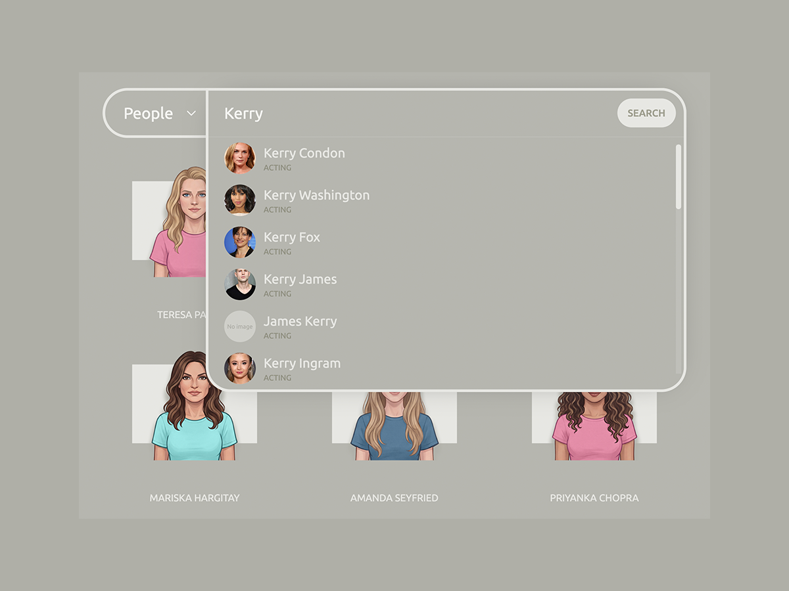
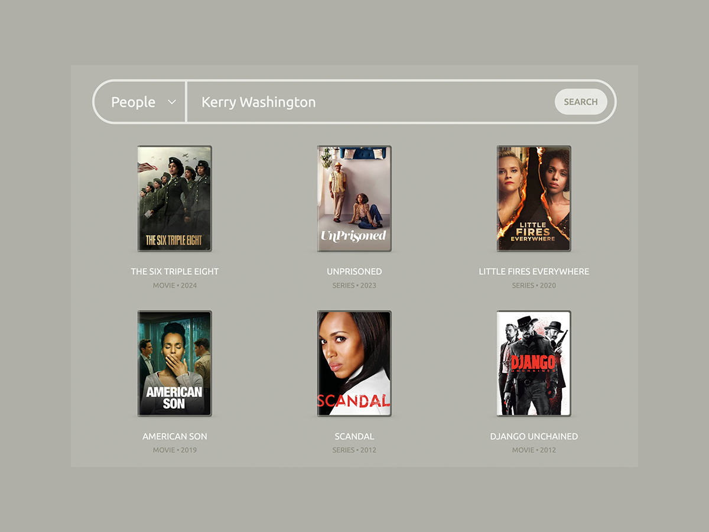

# Vue.js Movie & TV Show Finder

## Screenshots

## System requirements

- Node.js `24+`
- npm `11+`

## Required open ports

- `5173` – development server (Vite)
- `4173` – production build preview (Vite)

## API key

Generate your own API key on [TMDB](https://www.themoviedb.org/settings/api) and paste it as the value of `apiKey` in `src/components/AppMovieTvShowFinder.vue`

## How to run the project

1. `npm install` - install the dependencies
2. `npm run dev` - start the development server
3. `npm run lint` - lint the codebase
4. `npm run build` - build the application
5. `npm run preview` - preview the production build locally